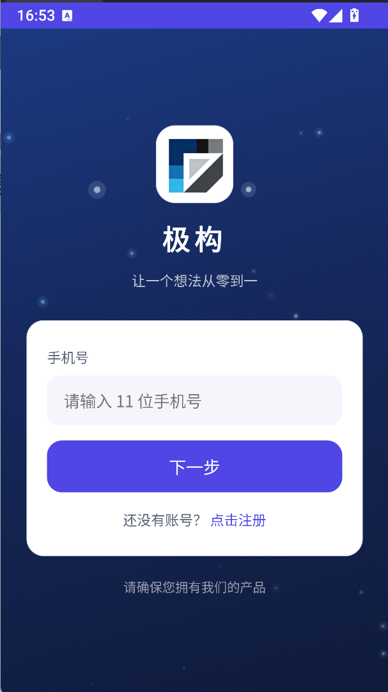
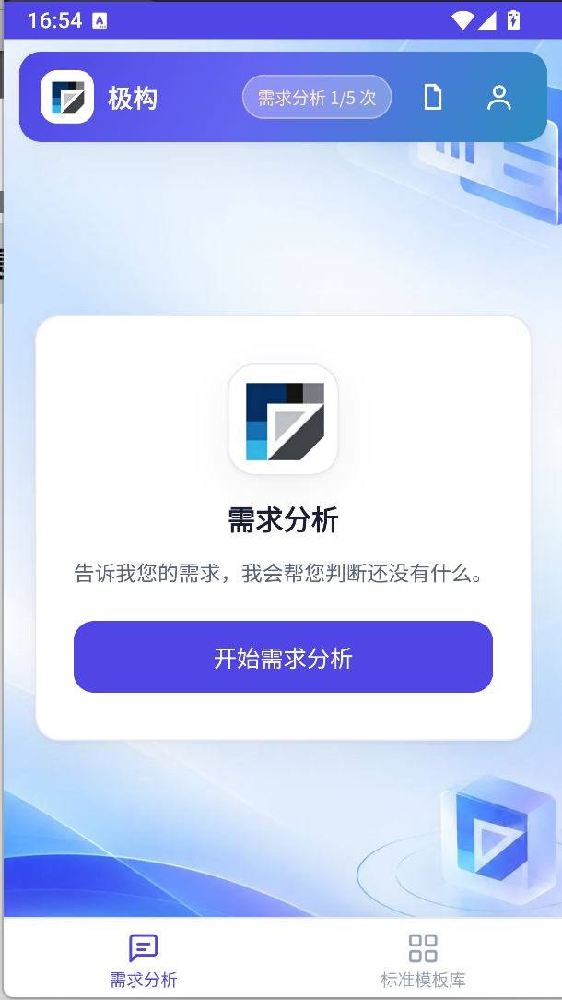
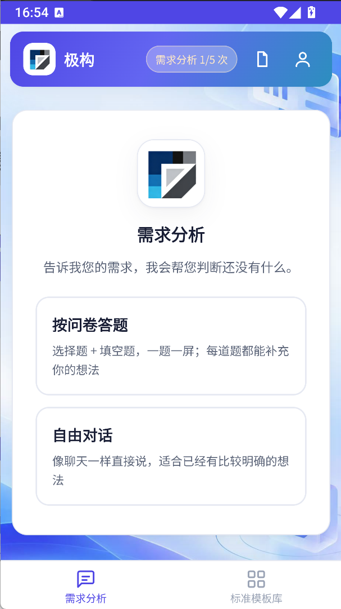
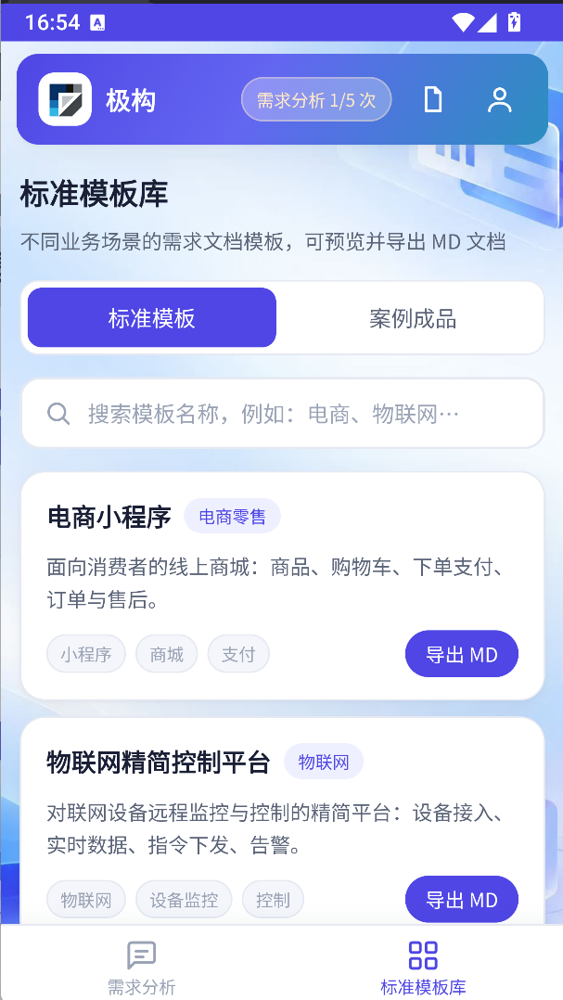
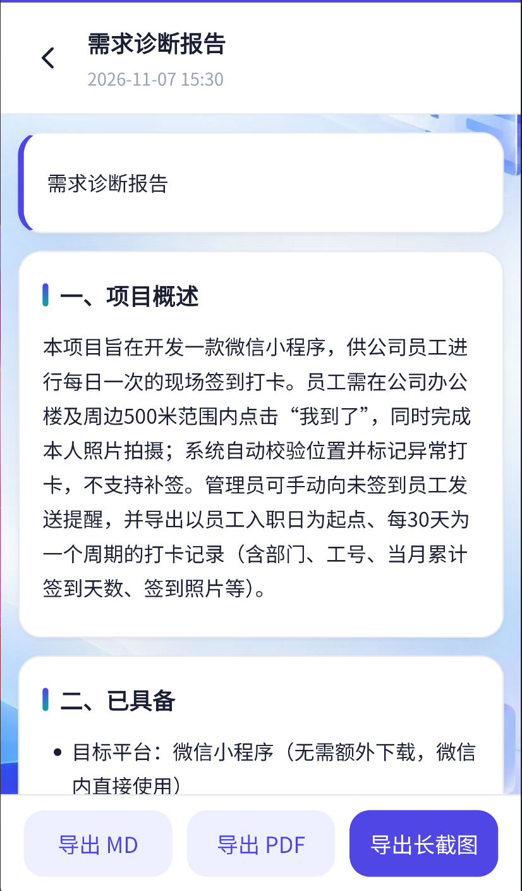
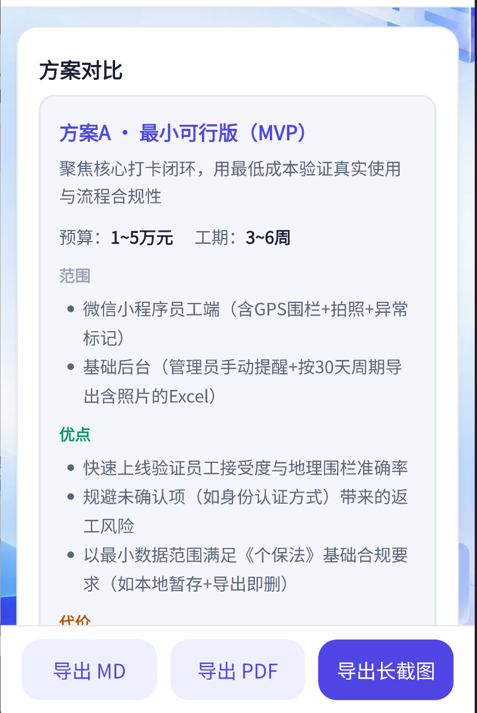

# 需求诊断顾问（Requirement Agent）

基于 LangChain + LangGraph 的智能需求分析 Agent：用户用自然语言描述项目想法，Agent 通过多轮对话澄清需求、检索知识库给出专业建议，最终自动生成一份结构化的《需求诊断报告》（支持 PDF 导出）。

## 界面预览

| 登录 | 需求分析入口 | 分析模式 |
|---|---|---|
|  |  |  |

| 标准模板库 | 需求诊断报告 | 方案对比（含预算/工期） |
|---|---|---|
|  |  |  |

> 诊断报告示例：Agent 对"员工签到打卡小程序"需求自动产出项目概述、已具备/还缺失清单、MVP 与完整版双方案对比（预算 1~5 万 / 20~50 万，工期 3~6 周 / 8~14 周），可导出 MD / PDF / 长截图。

## 功能亮点

- **Agent 工具调用**：基于 LangChain Agent Loop，LLM 可主动调用知识库检索等工具完成诊断
- **RAG 知识库**：内置 8 篇需求分析领域知识文档（需求文档规范、技术选型、澄清问题清单、权限设计、预算报价等），Chroma 向量库 + 百炼 Embedding 检索
- **多轮记忆**：LangGraph Checkpoint 管理对话状态，支持跨轮次上下文延续
- **流式输出**：FastAPI + NDXML 流式响应，打字机效果实时呈现
- **报告导出**：对话结束后自动汇总为需求诊断报告，支持 PDF 导出
- **前端**：Vue 3 + Vite，支持 PWA 移动端使用

## 项目结构

```
├── backend/            # Python 后端
│   ├── agent_core.py   # Agent 核心循环（工具调用 + 多轮记忆）
│   ├── 04_build_kb.py  # 知识库构建脚本（文档向量化入库）
│   ├── 06_web_app.py   # FastAPI 应用入口（流式接口）
│   ├── pdf_export.py   # PDF 报告导出
│   ├── db.py           # 数据库访问
│   └── kb/             # 知识库原始文档（Markdown）
├── frontend/           # Vue 3 + Vite 前端
├── deploy/             # 部署脚本
├── Dockerfile / docker-compose.yml
└── .env.example        # 环境变量模板
```

## 技术栈

Python 3.10 · LangChain · LangGraph · ChromaDB · 阿里云百炼（OpenAI 兼容接口，qwen 系列）· FastAPI · Vue 3 · Docker

## 快速开始

```bash
# 1. 配置环境变量
cp .env.example .env
# 编辑 .env，填入你的百炼 API Key

# 2. 构建知识库（首次运行）
cd backend
pip install -r requirements.txt
python 04_build_kb.py

# 3. 启动后端
python 06_web_app.py

# 4. 启动前端
cd ../frontend
npm install
npm run dev
```

也可使用 Docker Compose 一键部署：

```bash
docker-compose up -d
```

## 说明

本项目为华北五省计算机竞赛参赛作品。知识库文档位于 `backend/kb/`，可根据自己的业务领域替换扩充。

> API Key 等敏感信息统一通过 `.env` 注入，仓库内不含任何真实密钥。
